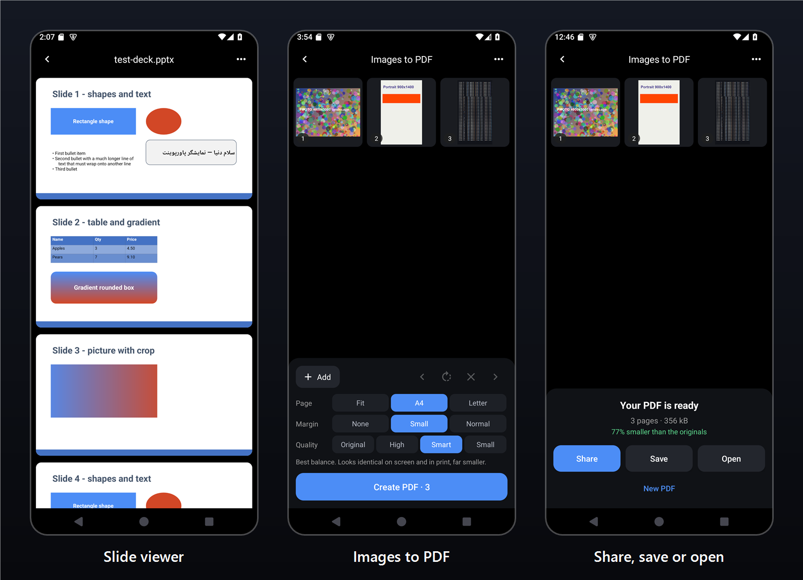

<div dir="rtl" align="center">


# LitePPTX

**نمایشگر فوق‌سبک پاورپوینت، اسکنر سند و سازنده PDF از عکس برای اندروید**
حدود ۱۳۰ کیلوبایت · بدون هیچ کتابخانه‌ی خارجی · بدون تبلیغ، حساب کاربری و ردیابی

[**دانلود APK**](https://github.com/Evilenor/LitePPTXViewer/releases/latest) · [Changelog](CHANGELOG.md) · [♥ حمایت](https://the-evilenor.vercel.app/support) · [English](README.md)



</div>

<div dir="rtl">

---

## چرا LitePPTX؟

برای دیدن یک فایل `.pptx` که توی چت برایتان فرستاده‌اند، لازم نیست یک مجموعه‌ی آفیس چند صد مگابایتی نصب کنید. برای اسکن یک برگه یا تبدیل چند عکس به یک PDF تمیز هم لازم نیست حساب بسازید، اشتراک بخرید یا واترمارک تحمل کنید. LitePPTX همه‌ی این کارها را در بسته‌ای کوچک‌تر از یک عکس گوشی انجام می‌دهد و خودش را بروزرسانی می‌کند.

- **سبک:** APK نسخه‌ی نهایی حدود ۱۳۰ کیلوبایت است و فقط از API‌های خود اندروید استفاده می‌کند.
- **سریع:** اسلایدها فقط وقتی به صفحه می‌رسند رندر می‌شوند و کش می‌شوند.
- **خصوصی:** بدون تبلیغ و آنالیتیکس. فایل‌های شما از گوشی بیرون نمی‌روند.
- **خودکار بروزرسانی می‌شود:** با یک ضربه، نسخه‌ی جدید دانلود، بررسی و نصب می‌شود.
- **دوزبانه:** رابط فارسی و انگلیسی، با نمایش درست متن راست‌به‌چپ در اسلایدها.

## قابلیت‌ها

### نمایشگر پاورپوینت
- باز کردن `.pptx` از مدیر فایل، تلگرام، واتس‌اپ، جیمیل، مرورگر یا منوی «اشتراک‌گذاری».
- فهرست عمودی اسلایدها به شکل کارت، شمارنده‌ی صفحه و بزرگ‌نمایی با دو انگشت.
- پشتیبانی از **مستر و لایه‌ی اسلایدها** (جایگاه، اندازه، فونت و رنگ ارث‌بری می‌شود)، شکل‌ها، مسیرهای آزاد، گروه‌ها، گرادیان، حاشیه، **جدول**، بولت و شماره‌گذاری، تراز عمودی متن و تصویرهای برش‌خورده.
- **متن راست‌به‌چپ** (فارسی و عربی) با ترازبندی و بولت درست.
- **خروجی PDF** (**⋯ ← خروجی PDF**): همه‌ی اسلایدها به صفحه‌ی PDF تبدیل می‌شوند و می‌توانید فایل را ذخیره، باز یا ارسال کنید.

### اسکنر سند
اسکنر به سبک CamScanner، بدون حساب کاربری، تبلیغ و آپلود: **اسکن سند** در صفحه‌ی اول، در منو، یا از میانبر آیکون برنامه.

- **گرفتن عکس یا انتخاب از گالری**، چند صفحه‌ی پشت‌سرهم. عکس را برنامه‌ی دوربین خود گوشی می‌گیرد، پس LitePPTX **مجوز دوربین نمی‌خواهد**.
- **تشخیص خودکار لبه‌ی کاغذ** یک چارچوب پیشنهاد می‌دهد و چهار گوشه را می‌توانید بکشید و اصلاح کنید (یا **کل عکس** / **خودکار** را بزنید). صفحه روی خود گوشی صاف می‌شود (اصلاح پرسپکتیو).
- **فیلترها:** *اصلی*، *تمیز* (سایه را برمی‌دارد و کاغذ را یکدست می‌کند)، *سیاه‌وسفید* و *خاکستری*، با پیش‌نمایش زنده. هر صفحه را می‌شود چرخاند.
- **ساخت PDF** از همه‌ی صفحه‌ها، بعد ذخیره در Downloads، باز کردن یا ارسال. هر صفحه به‌صورت JPEG با ضلع بلند حداکثر ۲۶۰۰ پیکسل ذخیره می‌شود.
- پردازش تصویر همگی کد خود برنامه است، بدون کتابخانه‌ی یادگیری ماشین و بدون Google Play Services، پس روی هر گوشی کار می‌کند.

### تبدیل عکس به PDF
عکس‌ها را در گالری انتخاب کنید، **اشتراک‌گذاری ← ساخت PDF** را بزنید و در چند ثانیه یک PDF تمیز و حرفه‌ای بگیرید.

- **جابه‌جایی، چرخاندن و حذف** صفحه‌ها پیش از ساخت.
- **اندازه‌ی صفحه:** هم‌اندازه با عکس، A4 یا Letter؛ عمودی/افقی برای هر عکس جداگانه انتخاب می‌شود.
- **حاشیه:** بدون، کم یا عادی.
- جهت EXIF رعایت می‌شود و PNG شفاف روی زمینه‌ی سفید قرار می‌گیرد.
- **اشتراک، ذخیره در Downloads یا باز کردن** فایل نهایی، همراه با حجم و میزان کم‌حجم‌تر شدن نسبت به عکس‌های اصلی.

#### فشرده‌سازی بدون آسیب به عکس

| حالت | کار | مناسب برای |
|---|---|---|
| **اصلی** | بدون تغییر اندازه؛ JPEG بایت‌به‌بایت داخل PDF می‌رود و PNG بدون افت می‌ماند | آرشیو، بیشترین کیفیت |
| **بالا** | تا ۳۰۰ dpi / ۳۶۰۰ پیکسل، JPEG با کیفیت ۹۰؛ اسکرین‌شات‌ها بدون افت | چاپ |
| **هوشمند** *(پیش‌فرض)* | تا ۲۰۰ dpi / ۲۶۰۰ پیکسل، کیفیت ۸۲؛ روی صفحه و چاپ یکسان دیده می‌شود، با حجم خیلی کمتر | استفاده‌ی روزمره |
| **کم‌حجم** | تا ۱۳۰ dpi / ۱۶۰۰ پیکسل، کیفیت ۶۸ | چت و ایمیل |

هیچ کتابخانه‌ی PDF استفاده نشده؛ برنامه خودش فایل PDF را می‌نویسد و داده‌ی JPEG را مستقیم داخلش می‌گذارد. بنابراین عکسی که از قبل کم‌حجم است **هیچ‌وقت دوباره فشرده نمی‌شود** و فقط وقتی کوچک می‌شود که پیکسل‌هایش بیشتر از چیزی باشد که صفحه در آن وضوح نشان می‌دهد.

در تست روی امولاتور (یک عکس ۴۰۰۰×۳۰۰۰، یک JPEG کوچک و یک اسکرین‌شات متنی، روی‌هم ۱٫۵ مگابایت) نتیجه این بود: حالت اصلی ۱٫۵۰ مگابایت، هوشمند ۷۵۸ کیلوبایت و کم‌حجم ۳۵۶ کیلوبایت.

### بروزرسانی درون‌برنامه‌ای
- حداکثر هر ۶ ساعت (و دستی از **⋯ ← بررسی بروزرسانی**) گیت‌هاب را بررسی می‌کند.
- روی نوار بروزرسانی بزنید تا «تغییرات نسخه» را ببینید، سپس **بروزرسانی**.
- پیش از باز شدن نصب‌کننده، فایل بررسی می‌شود (حجم، SHA-256 و هویت بسته) و اندروید هم هر فایلی را که با کلید یکسان امضا نشده باشد رد می‌کند.

## نصب

۱. فایل `LitePPTXViewer.apk` را از [آخرین ریلیز](https://github.com/Evilenor/LitePPTXViewer/releases/latest) دانلود کنید.
۲. بازش کنید. اگر اندروید پرسید، اجازه‌ی نصب از مرورگر یا مدیر فایل را بدهید.
۳. تمام. نسخه‌های بعدی از داخل خود برنامه نصب می‌شوند.

حداقل نسخه‌ی اندروید: **۵٫۰ (API 21)**. کنار هر ریلیز یک فایل `.sha256` برای بررسی صحت هم هست.

## محدودیت‌ها

- نمودار و SmartArt رندر نمی‌شوند و برخی شکل‌های آماده (فلش، ستاره) به شکل مستطیل کشیده می‌شوند.
- انیمیشن، ترنزیشن، یادداشت‌ها و فونت‌های جاسازی‌شده نادیده گرفته می‌شوند.
- فقط `.pptx` پشتیبانی می‌شود، نه `.ppt` قدیمی.
- جابه‌جایی صفحه‌ها با دکمه‌های ◀ ▶ است، نه کشیدن و رها کردن.
- اسکنر **OCR ندارد** (متن قابل جست‌وجو نمی‌سازد) و هنوز حالت کارت شناسایی ندارد. تشخیص خودکار لبه روی پس‌زمینه‌ی ساده بهتر کار می‌کند؛ روی پس‌زمینه‌ی شلوغ گوشه‌ها را با دست بکشید.
- روی گوشی‌های خیلی کم‌حافظه اسکنر خودش وضوح صفحه را کم می‌کند؛ این بخش فقط روی امولاتور آزمایش شده است.

اگر فایلی درست نمایش داده نشد، لطفاً [یک Issue](https://github.com/Evilenor/LitePPTXViewer/issues) با نمونه‌ی فایل باز کنید.

## حریم خصوصی

تنها ترافیک شبکه‌ی برنامه بررسی بروزرسانی (`api.github.com`) و دانلود APK هنگام زدن دکمه‌ی بروزرسانی است. فایل‌هایی که باز، اسکن یا تبدیل می‌کنید روی خود گوشی پردازش می‌شوند. اسکنر عکس را با برنامه‌ی دوربین خود گوشی می‌گیرد، پس LitePPTX هیچ‌وقت مجوز دوربین نمی‌خواهد. دکمه‌ی **حمایت** فقط صفحه‌ی حمایت را در مرورگر شما باز می‌کند و خود برنامه چیزی ارسال نمی‌کند. مجوزها: `INTERNET` (بروزرسانی) و `REQUEST_INSTALL_PACKAGES` (برای سپردن نسخه‌ی بررسی‌شده به نصب‌کننده‌ی اندروید).

## ساخت از روی سورس

```bash
git clone https://github.com/Evilenor/LitePPTXViewer.git
cd LitePPTXViewer
./gradlew assembleRelease   # JDK 17 و Android SDK (platform 35)
```

## حمایت از LitePPTX ♥

LitePPTX رایگان، متن‌باز و بدون تبلیغ است و همین‌طور می‌ماند. اگر وقتتان را گرفته یا کارتان را راه انداخته، حمایت شما باعث می‌شود نگهداری‌اش ادامه پیدا کند و بتوانم ابزارهای کوچک و صادقانه‌ی بیشتری بسازم.

<div align="center">

[**♥ حمایت از LitePPTX · the-evilenor.vercel.app/support**](https://the-evilenor.vercel.app/support)

</div>

داخل خود برنامه هم یک ضربه تا آن فاصله است: کارت **حمایت** در صفحه‌ی اول و **⋯ ← حمایت از برنامه ♥**. اگر نمی‌توانید حمایت مالی کنید، ستاره دادن به ریپو، معرفی به دوستان یا گزارش باگ هم همین‌قدر کمک می‌کند.

## مجوز

[MIT](LICENSE) © Evilenor

</div>
