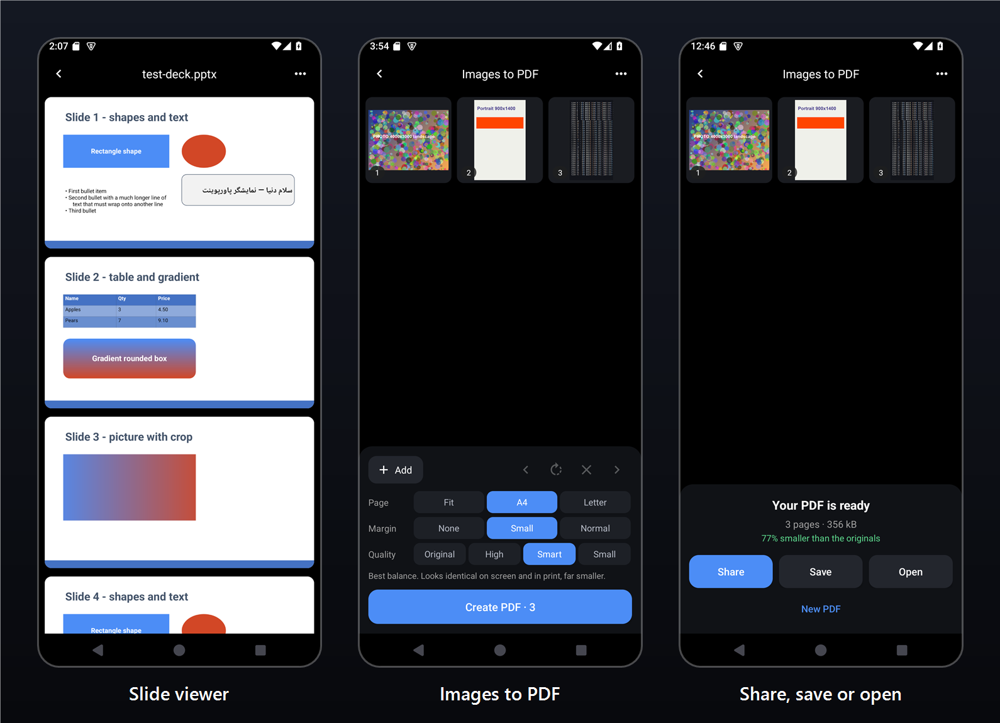

<p align="center">
  
</p>

<h1 align="center">LitePPTX</h1>

<p align="center">
  <b>A featherweight PowerPoint viewer, document scanner and photo-to-PDF maker for Android.</b><br>
  About 130&nbsp;KB. Zero dependencies. No ads, no accounts, no tracking.
</p>

<p align="center">
  <a href="https://github.com/Evilenor/LitePPTXViewer/releases/latest"></a>
  <a href="https://github.com/Evilenor/LitePPTXViewer/releases"></a>
  
  
  <a href="LICENSE"></a>
  <a href="https://the-evilenor.vercel.app/support"></a>
</p>

<p align="center">
  <a href="https://github.com/Evilenor/LitePPTXViewer/releases/latest"><b>Download the APK</b></a> ·
  <a href="CHANGELOG.md">Changelog</a> ·
  <a href="https://the-evilenor.vercel.app/support">♥ Support</a> ·
  <a href="README.fa.md">فارسی</a>
</p>

<p align="center">
  
</p>

---

## Why LitePPTX

Opening a `.pptx` someone sent you in a chat shouldn't need a 300&nbsp;MB office suite. Scanning a receipt or turning five photos into one clean PDF shouldn't need an account, a subscription or a watermark. LitePPTX does all of it, in a package smaller than a single phone photo, and updates itself.

| | |
|---|---|
| **Tiny** | The release APK is about 130&nbsp;KB. Only Android platform APIs are used. There is not a single third-party library. |
| **Fast** | Slides are rendered lazily, only when they scroll into view, and cached. Opening a deck takes about a second on an emulator. |
| **Private** | No analytics, no ads, no permissions to read your files. Your documents never leave the phone. |
| **Self-updating** | The app notices new releases by itself and keeps a dot on the **⋯** button until you update. Download once: it is remembered, verified, and offered for install even after you close the app. |
| **Bilingual** | English and Persian UI, with proper right-to-left text rendering in slides. |

## Features

### PowerPoint viewer
- Opens `.pptx` from file managers, Telegram, WhatsApp, Gmail, browsers, or the *Share* menu.
- Vertical, card-style slide list with a page counter, and pinch-to-zoom.
- Understands slide **masters and layouts** (placeholders inherit position, size, fonts and colours), shapes (rectangles, rounded rectangles, ellipses, lines, freeform paths, groups), gradient and solid fills, borders, theme colours with tints, **tables**, bullets and numbering, text anchoring and autofit, and pictures with cropping.
- **Right-to-left text** (Persian, Arabic) with correct alignment and bullets.
- Everything is parsed and drawn by the app itself, straight from the file's XML.
- **Export as PDF** (**⋯ > Export as PDF**): every slide is rendered to a page, then you can save, open or share the file.

### Document scanner
A CamScanner-style scanner with no account, no ads and no upload: **Scan document** on the start screen, in the menu, or as a launcher shortcut.

- **Take photos or pick them** from the gallery, several pages in a row. The photo is taken by your phone's own camera app, so LitePPTX needs **no camera permission**.
- **Automatic page detection** proposes the outline of the paper, and you can drag the four corners to fix it (or tap *Full photo* / *Auto*). The page is straightened (perspective corrected) on the device.
- **Filters:** *Original*, *Clean* (removes shadows and evens out the paper), *B&W* and *Gray*, with a live preview. Rotate any page.
- **Create PDF** from all the pages, then save to Downloads, open or share. Each page is stored as a JPEG with a long edge of up to 2600&nbsp;px, which keeps text sharp and files small.
- All the image processing is our own code, with no ML library and no Google Play Services, so it works on any phone.

### Images to PDF
Select photos in your gallery, tap **Share > Create PDF**, and get a clean, professional PDF in seconds.

- **Reorder, rotate, remove** pages before creating.
- **Page size:** Fit (page matches each image), A4 or Letter. Portrait and landscape are chosen per image.
- **Margins:** none, small or normal.
- **Honours EXIF orientation**, so phone photos come out the right way up. Transparent PNGs are flattened onto white.
- **Share, save to Downloads, or open** the finished file, with the size and the saving versus your originals shown.

#### Compression that respects your pictures

| Preset | What it does | Best for |
|---|---|---|
| **Original** | No resampling. JPEGs are embedded **byte-for-byte**, PNGs stay lossless. | Archiving, maximum fidelity |
| **High** | Up to 300 dpi / 3600 px, JPEG q90. PNG screenshots stay lossless. | Printing |
| **Smart** *(default)* | Up to 200 dpi / 2600 px, JPEG q82. Looks identical on screen and in print, far smaller. | Everyday use |
| **Small** | Up to 130 dpi / 1600 px, JPEG q68. | Chat and email |

Under the hood there is no PDF library. LitePPTX writes the PDF itself and embeds JPEG data directly, so a photo that is already small enough is **never re-encoded**. Images are only downscaled when they carry more pixels than the page can show at the chosen resolution.

In our emulator test (a 4000×3000 photo, a small JPEG and a text-heavy PNG screenshot, 1.5&nbsp;MB in total) the results were 1.50&nbsp;MB with *Original*, 758&nbsp;kB with *Smart* and 356&nbsp;kB with *Small*.

### Updates
- Checks GitHub Releases at most every 6 hours (and on demand from **⋯ > Check for updates**).
- Tap the update bar to read *What's new*, then **Update**.
- Until you update, a red dot stays on the **⋯** button and the menu entry reads *Update to v…* or *Install v…*.
- A finished download is remembered: even after you close the app or go offline, the bar comes back as "ready to install" and you do not have to download again.
- The APK is verified (size, SHA-256, package identity) before Android's installer opens, and Android refuses anything not signed with the same key.

## Install

1. Download `LitePPTXViewer.apk` from the [latest release](https://github.com/Evilenor/LitePPTXViewer/releases/latest).
2. Open it. If Android asks, allow installs from your browser or file manager.
3. Done. Future versions install from inside the app.

Requires **Android 5.0 (API 21)** or newer. Integrity: each release ships a `.sha256` file (`sha256sum -c LitePPTXViewer.apk.sha256`).

## Using it

- **View a presentation:** open any `.pptx` file, or launch the app and tap *Open PowerPoint*.
- **Scan a document:** tap *Scan document*, take or pick photos, adjust the corners, choose a filter, then *Create PDF*. Long-press the app icon for a shortcut.
- **Make a PDF from photos:** select images in Gallery / Photos / Files, tap *Share*, choose **Create PDF**. Or long-press the app icon and pick *Images to PDF*.

## Limitations

LitePPTX is deliberately minimal:

- Charts and SmartArt are not rendered; some preset shapes (arrows, stars) are drawn as rectangles.
- Animations, transitions, notes and embedded fonts are ignored (system fonts are used).
- Only `.pptx` is supported, not legacy `.ppt`.
- Page reordering uses the ◀ ▶ buttons rather than drag and drop.
- The scanner has **no OCR** (no searchable text) and no ID-card mode yet. Automatic edge detection works best on a plain background; on a busy one, drag the corners by hand.
- On very low-memory phones the scanner reduces the page resolution automatically; this has only been tested on an emulator so far.

Rendering fidelity has been checked on an Android 15 emulator with test decks; real-world files vary, so please [open an issue](https://github.com/Evilenor/LitePPTXViewer/issues) with a sample if something looks wrong.

## Privacy

LitePPTX has no analytics and no ads. Its only network traffic is the update check (`GET api.github.com/.../releases/latest`) and, when you tap Update, the APK download from GitHub. Files you open, scan or convert are processed on the device. Scanning uses your phone's camera app to take the photo, so LitePPTX never asks for the camera permission. The **Donate** button only opens the support page in your browser; the app itself sends nothing. Declared permissions: `INTERNET` (updates) and `REQUEST_INSTALL_PACKAGES` (to hand the verified update to Android's installer).

## Build from source

```bash
git clone https://github.com/Evilenor/LitePPTXViewer.git
cd LitePPTXViewer
./gradlew assembleRelease      # needs JDK 17 and the Android SDK (platform 35)
```

The APK lands in `app/build/outputs/apk/release/`. Without signing secrets it is signed with the debug key.

### Project layout

```
app/src/main/java/com/litepptx/viewer/
  MainActivity.kt        viewer screen, update bar
  PdfMakerActivity.kt    Images to PDF editor and share target
  ScanActivity.kt        document scanner: capture, crop, filter, PDF
  scan/                  page detection, perspective warp, filters, crop view
  pptx/                  PPTX parser and slide renderer (pure Android APIs)
  pdf/                   streaming PDF writer, image pipeline, slide-to-PDF export, file provider
  update/Updater.kt      GitHub Releases updater
```

### Releasing

CI (`.github/workflows/build-apk.yml`) builds every push and pull request. Pushing a tag publishes a release:

```bash
# 1. bump versionCode / versionName in app/build.gradle.kts
# 2. write release-notes/vX.Y.Z.md and update CHANGELOG.md
git tag vX.Y.Z && git push origin vX.Y.Z
```

The workflow signs the APK with the key stored in repository secrets and attaches `LitePPTXViewer.apk` and its `.sha256` to the release; the in-app updater picks it up from there.

## Support LitePPTX ♥

LitePPTX is free, open source and ad-free, and it will stay that way. If it saved you time, a donation keeps it maintained and lets me keep building small, honest tools.

<p align="center">
  <a href="https://the-evilenor.vercel.app/support"></a>
</p>

It is also one tap away inside the app: the **Donate** card on the start screen and **⋯ → Donate ♥**. Can't donate? Starring the repo, sharing it with a friend or reporting a bug helps just as much.

## License

[MIT](LICENSE) © Evilenor
